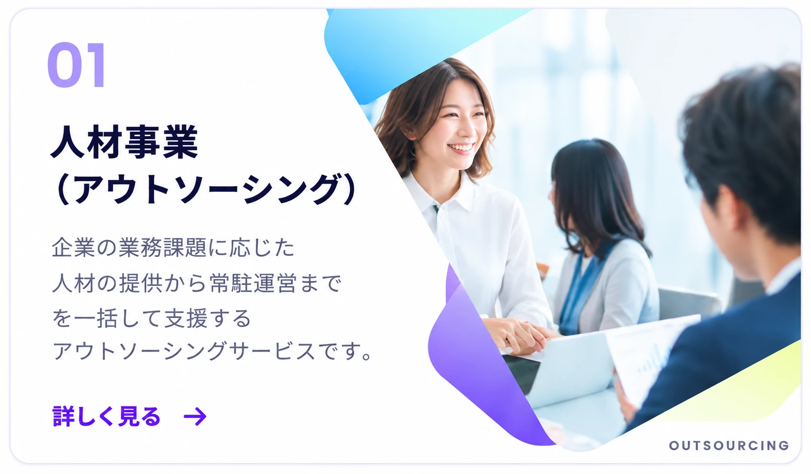

# ELEVATE サイト運用・開発ガイド

HTML・CSS・JavaScriptとPHPで構成したサイトです。KAGOYAへの配置時はビルド不要です。フォームの送信とnote記事の自動取得はPHPで動作します。

サイト構成・編集方法・公開手順・確認履歴はこのファイルにまとめています。個別の通知先や作業の引き継ぎ情報は、Git管理対象外の `.local-notes/deployment-handoff.md` で管理し、公開用ファイルには含めません。

## 現在の状況（2026-10-21）

- 本番：`https://elevate-works.jp/`。リニューアル版による本番上書きは未実施です。
- ステージング：`https://elevate-works.jp/stg/`。FileZillaで配置し、ユーザーがnoteの自動更新を確認済みです。
- noteの取得元は正式アカウント `https://note.com/elevate`。最新6件を表示します。
- 現行ファイル一式は受領済みです。ユーザーがステージングの全4フォームについて、現行の受信先への切り替え後も着信確認完了を報告しました。本番環境での確認は未実施です。
- 公開作業はユーザー本人が行う予定です。現在の操作権限はステージングのみのため、本番の権限と配置先を確認してからバックアップ・反映を行います。
- 本番公開前に、現行サイトのバックアップ・新旧URL対応・メール設定・実環境でのフォーム動作を確認します。

## 共通ファイル

ご指定の「commn」に統一しています（「common」表記のディレクトリは作成していません）。

- `commn/css/common.css`：リセット、基本レイアウト、共通ホバー、装飾背景。
- `commn/css/site-shell.css`：全ページ共通のヘッダー／フッター、パンくずリスト、スマートフォンメニュー。
- `commn/css/experience.css`：YAOYAの余白・配置・動きを参考にした全ページ共通のレイアウト。各ページのCSSより後に読み込みます。
- `commn/js/common.js`：共通処理（年表示、固定ヘッダー、スクロール演出）。
- `commn/template.html`：新規ページ用HTMLテンプレート。

各HTMLに日本語設定・文字コード・viewport・タイトル・description・共通ヘッダー／フッター・本文領域を配置しています。ページ固有の処理がない下層ページは、空のCSS／JavaScriptを読み込みません。ヘッダー／フッターのスタイルとスマートフォンメニュー処理は共通ファイルで管理します。HTML構造を変更する場合は各ページとテンプレートに反映してください。

## URL・ファイル一覧

| ページ | URL | HTML |
| --- | --- | --- |
| TOP | `/` | `index.html` |
| サービス内容 | `/service/` | `service/index.html` |
| 総合人材派遣サービス | `/service/staffing/` | `service/staffing/index.html` |
| 人材派遣 | `/service/staffing/staffing-agency/` | `service/staffing/staffing-agency/index.html` |
| 業務請負 | `/service/staffing/contract-work/` | `service/staffing/contract-work/index.html` |
| 人材紹介 | `/service/staffing/recruitment-agency/` | `service/staffing/recruitment-agency/index.html` |
| IT・DX事業 | `/service/dx/` | `service/dx/index.html` |
| システム開発 | `/service/development/` | `service/development/index.html` |
| システムエンジニアリングサービス | `/service/engineering/` | `service/engineering/index.html` |
| DX実装支援 KAKEHASHI | `/service/ai/` | `service/ai/index.html` |
| お仕事紹介をご希望の方 | `/introduction/` | `introduction/index.html` |
| 総合人材派遣サービス | `/introduction/staffing/` | `introduction/staffing/index.html` |
| フリーランスエンジニア ELEVATE | `https://elevate-works.jp/lp/` | 外部の既存LPへ遷移 |
| よくあるご質問 | `/introduction/faq/` | `introduction/faq/index.html` |
| 登録スタッフの方 | `/registered/` | `registered/index.html` |
| 前払い申請フォーム | `/advance-payment/` | `advance-payment/index.html` |
| 交通費申請フォーム | `/transportation-expenses/` | `transportation-expenses/index.html` |
| かんたんWeb登録 | `/web-registered/` | `web-registered/index.html` |
| 企業向けお問い合わせ | `/contact/` | `contact/index.html` |
| 会社概要 | `/company/` | `company/index.html` |
| プライバシーポリシー | `/privacy/` | `privacy/index.html` |

## ディレクトリと命名

各ページのディレクトリに `index.html` を配置しています。ページ固有のスタイルや処理が必要になった時点でCSS／JavaScriptを追加してください。TOP専用ファイルはルート直下の `css/style.css` と `js/script.js` です。

KAKEHASHIはサービス階層を揃え、`service/ai/index.html` としています。旧 `service/engineering/ai-link-merged.html` はHTMLによる転送ページです。サーバーの301転送設定とは別の仕組みなので、本番移行時に既存設定と合わせて確認してください。

前払い申請・交通費申請・LPはサイトマップのURLどおりルート直下です。メニュー上の親子関係とURLのディレクトリ階層は必ずしも一致しません。

## 確認方法

`index.html` をブラウザで開くとTOPのページ一覧から全ページに移動できます。リンクはローカルで直接開ける相対パスです。

添付の `/service/` のようなURLでも確認する場合は、このフォルダで次を実行します（Python 3が必要です）。

```sh
python3 -m http.server 8000
```

ブラウザで `http://localhost:8000/` を開きます。終了は `Ctrl+C` です。

## 編集・追加方法

1. 本文を各HTMLの `<main>` 内に追加し、タイトルとdescriptionを更新します。
2. 全ページ共通のデザインは `commn/css/common.css`、個別のデザインは各ページのCSSに記述します。
3. 共通処理は `commn/js/common.js`、個別の処理が必要な場合だけページ用JSを追加します。
4. ページ追加時は `commn/template.html` をコピーします。
5. テンプレートの相対パス（共通CSS・JS、ナビゲーション）を階層に合わせて修正します。

## フォームの確認・送信処理

4つのフォームは、新デザインの同一ページ内で「入力 → 確認 → 送信完了」と進みます。入力修正時と送信失敗時は入力値・添付ファイルを保持します。現行サイトへの転送は行いません。確認画面の入力値はHTMLとして解釈せず、テキストとして表示します。

| フォーム | PHP処理 | 環境変数の接頭辞 | 添付 |
| --- | --- | --- | --- |
| Web登録 | `web-registered/submit.php` | `ELEVATE_REGISTRATION` | 写真1点、5MB以下 |
| お問い合わせ | `contact/submit.php` | `ELEVATE_CONTACT` | なし |
| 前払い申請 | `advance-payment/submit.php` | `ELEVATE_ADVANCE` | 証明書2点まで、各5MB以下 |
| 交通費申請 | `transportation-expenses/submit.php` | `ELEVATE_TRANSPORTATION` | なし |

お問い合わせ・前払い・交通費の画面操作は `commn/js/mail-form.js`、スタイルは `commn/css/mail-form.css`、PHP処理は `commn/php/mail-form.php` で共通管理しています。各ページのPHPがフォーム種別を固定し、通知先と件名を分けます。Web登録は専用のJS・PHPを使います。

最終送信時のみ `fetch` で各ページの `submit.php` にPOSTし、成功応答後に送信完了画面を表示します。送信中は修正・送信ボタンを無効化します。PHP側でも必須項目・同意を検証し、お問い合わせは確認用メールアドレスとの一致、前払い申請は正の整数の日数・受け取り方法への同意、Web登録は生年月日などを検証します。添付は拡張子と実ファイルのMIME形式、各5MB上限を検証します。CSRF対策・セッションのフォーム別分離・同一リクエストの再試行による重複メール防止を実装しています。

通知は各フォームの設定先へメール1通で送ります。申込者への自動返信は実装していません。交通費申請には現行と同じくメールアドレス欄がないため、申込者の `Reply-To` は付けません。入力情報・添付をブラウザの永続ストレージや公開ディレクトリへ保存しません。

### サーバー設定

1. 本番サーバーがPHP 8.1以上・fileinfo・セッション・`mail()`による送信に対応していることを確認し、HTTPSで公開します。
2. このリポジトリのHTML・CSS・JSと、各フォームの `submit.php`、共通の `commn/php/mail-form.php` を同じサーバーへ配置します。GitHub Pages用の `_site` 出力はPHPを含まないため、本番PHPサーバーへの配布には使用しないでください。
3. **PHPサーバー上でのみ** 各フォームの `mail-config.example.php` を同じフォルダの `mail-config.local.php` にコピーします。`to` に通知先、`from` にサーバーで送信を許可された自社ドメインのアドレスを設定します。アドレスは未確定のため初期値は空です。フォームごとに宛先を設定できます。環境変数を使う場合は上表の接頭辞に `_TO` / `_FROM` を付けます。ローカル設定ファイルがある場合はそちらが優先されます。
4. PHPの `upload_max_filesize` を5MB以上、`post_max_size` をフォームと添付2点が収まる値（例：16MB）に設定し、Webサーバーの本文サイズ制限も合わせます。サーバーのメール送信設定・送信ドメイン認証は管理者に確認してください。
5. 本番相当の環境で各フォームの確認・修正・添付・送信完了と**通知メールの実着信**を確認してください。`mail()`の成功は配送受付を示し、着信を保証しません。

設定未完了またはPHPが動かない場合、確認画面の送信ボタンを無効化します。ローカルのLive ServerとGitHub Pagesでは確認画面まで表示できますが、メールは送信しません。JavaScript無効時はお問い合わせ・前払い・交通費の「確認画面へ進む」を無効にし、有効化の案内を表示します。

PHP対応のローカル環境で確認する場合は `php -S 127.0.0.1:8000` をこのフォルダで実行し、各フォームのURLを開きます。実アドレスの設定なしでは送信できません。`python3 -m unittest discover -s tests -v` はメール代替プログラムを使うため、外部にメールを送信せず送信処理を検証します。ステージングの4フォームは現行受信先での着信までユーザーが確認済みです。本番環境での確認は未実施です。

## 共通ホバーアニメーション

`commn/css/common.css` で管理します。各ページで以下のクラスを付けて使います。

```html
<!-- 画像だけを0.3秒で少し薄くする（子孫のimgが対象） -->
<a class="hover-image" href="service/index.html">
  
</a>

<!-- テキストの下線を0.3秒で左から伸ばす -->
<a class="hover-underline" href="company/index.html">会社情報</a>
```

画像単体には `` と指定できます。
時間は `--hover-duration`（初期値 `0.3s`）、画像の透明度は `--hover-image-opacity`（初期値 `0.75`）で調整できます。
キーボードのフォーカス時にも適用します。タッチ操作ではホバーを適用せず、動きを減らす設定ではアニメーションを省略します。

ヘッダー・フッターのボタンや文字ロゴには `hover-fade` を使用します。
矢印を除き文字だけに下線を付ける場合は、リンクに `hover-trigger`、文字を囲む `span` に `hover-underline` を付けます。

## 共通レイアウト・ページ表示の動き

参考サイト：https://yaoya.io/

- セクション間の余白を広げ、見出し、角丸パネル、カードの間隔を共通化しています。サービス一覧はPCで2列、スマートフォンで1列です。会社情報・FAQ・プライバシーポリシーは読みやすい幅に絞り、フォームは中央の1列構成にしています。
- アニメーション対象は描画前から非表示にし、初回表示時、またはページ遷移終了後に表示します。本文は下から42px（スマートフォンは24px）移動しながら約0.82秒でフェードインします。複数要素は最大0.21秒ずつ開始をずらします。
- カード、フォーム、FAQなどはまとまりで動かし、親子のアニメーションが重ならないようにしています。`data-reveal="left"` / `"right"` で横方向も指定できます。キーボードで対象内にフォーカスした場合はすぐ表示します。
- 内部ページへの移動は約0.18秒でフェードアウトし、移動先を約0.35秒でフェードインします。同一ページのアンカー・外部リンク・別タブ・修飾キー操作は通常のリンクとして動きます。`data-no-transition` で個別に遷移演出を無効化できます。
- カードはマウスホバーでわずかに浮き上がります。スクロールはブラウザの標準動作です。背景の装飾には軽いカーソル追従を残しています。
- 共通ヘッダーは上部に固定し、スクロール後に高さをコンパクトにします。ホバー時はメニュー下の点と大きな角丸パネルを表示し、リンクが順番に現れます。アンカー位置はヘッダー高に合わせて調整します。
- PCでは小さな点がマウス位置へ即座に移動し、半透明の円が遅れて追従します。リンク上では円が広がります。入力欄・ダイアログ・キーボード操作・タッチ操作では標準カーソルを使用します。

処理は `commn/js/common.js`、見た目は `commn/css/experience.css` で管理します。動きを減らす設定では演出を省略します。JavaScript無効時・印刷時にも本文を表示します。

## お客様の声とnoteの連携

サービス内容の直下に、noteの記事画像・タイトル・投稿日を表示します。記事は別タブで開き、画像なしの場合はELEVATEロゴを使います。PC3枚・タブレット2枚・スマートフォン約1枚のスライダーです。

### KAGOYAなどPHPサーバーでの自動更新（FileZilla）

`index.html` が `js/script.js` から同一サーバーの `commn/php/note-voices.php` を呼び出します。PHPが `https://note.com/elevate/rss` を取得し、最新6件を返します。記事追加のたびの生成・再アップロードやcron設定は不要です。アカウントの公開記事すべてが対象です。

- ページを開く・リロードすると取得します。開いたままの画面を定期更新する処理はありません。
- 取得結果はサーバーの一時領域に5分間保存します。5分経過後のアクセスで更新します。更新時は取得URLに時刻を付け、note側の配信キャッシュに残った古いRSSを避けます。
- 取得失敗時は直前に取得した記事を返し、再試行を5分抑制します。初回取得もできなければ、HTMLに掲載済みの記事をそのまま表示します。
- 正常なRSSが0件になれば準備中に切り替えます。最大6件で、7件目以降は古い記事から表示対象外になります。
- PHP 8.1以上、SimpleXML、外部HTTPS通信、書き込み可能なPHP一時領域が必要です。通信にはcURLを優先し、未導入ならHTTPSストリームを使用します。
- 取得元・件数はPHP冒頭の `SOURCE` / `LIMIT`、保存時間は `TTL` で管理します。公開URLや件数を変更する場合はこちらを更新します。下記の静的生成用JSONとは独立しています。

FileZilla用フォルダは `python3 scripts/prepare_stg.py` でデスクトップ直下の `ELEVATE-stg-upload/` に新規作成できます。既存フォルダを上書きしません。HTML・CSS・JS・画像・PHP・ローカルメール設定を含み、Git・ローカルメモ・テスト・ビルド設定・メール設定サンプルを除外します。フォルダの**中身**をステージングの公開フォルダへ配置してください。すでにサーバー側で送信元などを設定した `mail-config.local.php` は上書きしないでください。

アップロード後は、サイト直下の `commn/php/note-voices.php` を開いてJSONの `cards` が返ることと、トップの記事表示を確認します。503の場合はPHP拡張・外部通信・一時領域を確認してください。ステージング上の自動更新はユーザーが確認済みです。

### ローカル確認・GitHub Pages向け静的生成

`python3 -m unittest discover -s tests -v` でRSS解析・キャッシュ・障害時の保持・フォームを確認できます。PHPの表示確認は `php -S 127.0.0.1:8000` を実行し、`http://127.0.0.1:8000/` を開きます。静的プレビューやPHPなしの環境では、HTML内の記事表示を維持します。

GitHub PagesはPHPを実行しないため、既存のPythonビルドとActionsを使います。`config/note-voices.json` の `magazine_url` を優先し、未設定なら `account_url` のRSSから最新 `limit` 件を取得します。両方空なら準備中です。`collection_url` は取得元が未設定の場合のリンク先です。

```sh
python3 scripts/build_note_voices.py
python3 -m http.server 8000 --directory _site
```

`_site/` はPHPを除外した静的公開専用です。KAGOYAへのアップロードには使わないでください。`--update-source` を指定すると、実際のRSSで元の `index.html` も更新できます。オフライン確認には `--fixture /path/to/sample-rss.xml --output /tmp/elevate-preview` を使います。

`.github/workflows/note-voices-pages.yml` はmainへのpush・毎時23分（UTC）・手動実行で静的サイトを生成します。利用時はGitHub Settings → Pagesの公開元をGitHub Actionsに変更してください。コードはGitHubへpush済みです。GitHub Pages側の公開設定・定期更新の有効化状況は未確認です。

NEWSは遷移しないテキスト表示です。ページトップボタンは全ページ共通で、ヒーローの下端が固定ヘッダーの下に入ると右下に表示されます。ヒーローのないページでは一定距離スクロールすると表示されます。SCROLLアイコンはホバー・フォーカス時に下へ6px動きます。

## TOPの初期表示

ロゴとキャラクターを使ったローディング画面を表示します。`js/script.js` の `initHomeLoader` で管理し、動きを減らす設定やページ遷移時の状態に応じて省略します。背景のELEVATEロゴ画像は左からぼかしが解けながら浮かび上がり、動きを減らす設定では静止表示します。

## セクションの装飾背景

TOPの背景は現在、bodyの `page-art` クラスでページ全体に固定配置しています。各セクションの `section-art` は外し、共通の一枚を見せています。濃度は `--page-art-opacity`（PC: 0.65、スマートフォン: 0.45）で変更できます。FVのメインビジュアル・ヘッダー・フッターは既存の背景を重ねて表示します。

SP（767px以下）のページ共通背景は `images/common/section-background-sp.webp` に切り替わります。

HERO内の高さ・文字・ボタン・余白は `clamp()` で下限と上限を持たせています。中間幅で過度に縮小したり、幅広のスマートフォンで過大になったりしない設定です。SPは縦並びと画像の縦横比から高さが決まります。

## SPメニュー

767px以下では本文と同じ淡い背景画像・ネイビー文字の全画面メニューを表示します。リンクの順次表示、Web登録・お問い合わせ導線、背景のスクロール停止とinert化、Tabキーのフォーカス循環、Escで閉じる操作に対応します。横向きなど高さが足りない画面ではメニュー内をスクロールできます。768px以上へ広げた際は閉じて通常ナビゲーションへ戻します。

ホバー演出は768px以上かつマウス等でホバー可能な端末に限定しています。SPではメニュー開閉・登場演出とキーボードのフォーカス表示を維持します。

## サービスサブメニュー

768px以上でヘッダーの「サービス内容」「お仕事紹介をご希望の方」「登録スタッフの方」にホバーまたはキーボードフォーカスすると、既存の下層ページへのリンクを表示します。項目は `commn/js/common.js` の `definitions`、表示は `commn/css/experience.css` で共通管理しています。Escで閉じる操作と、スマートフォンへの切り替え時の解除に対応しています。

## 浮遊する背景画像

TOPの `.floating-background` 内に6枚の装飾画像を配置しています。`commn/css/common.css` の各 `nth-child` で位置・サイズ・濃度・移動距離・周期を変更できます。17〜26秒の異なる周期で緩やかに浮遊します。SPは小さく薄くし、動きを減らす設定では静止します。メニュー・モーダル表示中は一時停止します。表示用画像は `images/common/floating-orb-01.webp` 〜 `06.webp` です。

TOPと共通背景は表示用にWebPを使用し、元のPNGは再編集用ソースとして残しています。

## ELEVATEオリジナルキャラクター

`images/common/mascots/` は、ご提供のキャラクター画像をもとに背景を透過したエレ・サポ・ミル・チャレのPNG素材です。各ページの見出しには配置せず、TOPではヒーローの左下、下層ページでは背景パネルとは独立させ、ヒーロー右下の縁に重ねて1体ずつ配置しています。見出しやボタンとは重ならない案内エリアを確保しています。画像内の紹介文はサイトへ追加していません。キャラクターをクリックするとページごとの案内を吹き出しに表示します。案内文は各HTMLの `data-mascot-guide` で編集できます。再クリック・閉じるボタン・外側のクリック・Escで閉じ、同時に開く吹き出しは1つです。キーボード操作とスマートフォンのタップに対応し、浮遊は動きを減らす設定で停止します。

TOPはコピーを上段、ボタンを右下段にずらしたファーストビューです（SPもコピーの下にボタンを配置）。写真エリアは削除し、ELEVATEのロゴ画像が左からぼかしを解きながら現れ、薄い背景として残ります。再訪・ページ遷移にも対応し、動きを減らす設定では静止表示します。サービス一覧の写真は `object-fit: contain` で全体を表示します。お客様の声の記事画像は16:9のカードに合わせます。

全ページに Google Fonts の M PLUS Rounded 1c を読み込み、`"M PLUS Rounded 1c", "Hiragino Maru Gothic ProN", "Yu Gothic", system-ui, sans-serif` の順に適用しています。

## 本番公開前の準備

公開方針は、同じドメインと主要ページURLで旧企業サイトをリニューアル版へ置き換えることです。ユーザー確認により、既存ページとして残すのは `/lp/` とその必要ファイルのみです。新サイトの会社概要からリンクするPDFは資料として維持します。旧企業サイトのページを新HTMLと併存させる方針ではありません。

以下のURL対応・転送・保持対象は、受領ファイルを基にした公開案です。本番バックアップの代わりにはなりません。現時点でサーバー設定や公開ファイルへ適用していません。

1. 受領済みの現行ファイルを確認し、不足分とサーバー上の実設定を確認します。受領物は新サイトに上書きせず、別フォルダに保管しています。2026-10-21の調査で、旧フォームに旧ドメインと仮設定に見える送信元があること、共通PHPが参照する `vendor/autoload.php`、転送設定が参照する `404.php` と `lp/public_html/index.php` が受領物にないことを確認しました。設定をそのままコピーせず、先方に確認します。
2. 現行本番の全ファイル・設定をバックアップし、元に戻せる状態を用意します。
3. 新旧URLの対応表を作り、同じURLは維持し、変更するURLだけに対応する301転送を準備します。2026-10-21の公開ページ調査では、旧 `/human-register/`（人材登録フォーム）が新サイトにないことと、既存の `/index.php` が表示されることを確認しました。旧フォームの転送先やトップの表示優先順は、現行ファイル受領後に確定します。
4. `/lp/` と、会社概要からリンクする `/company/pdf/` の既存PDFを保持します。旧PHPを残したまま上書きして旧ページが表示され続けないよう、残すファイルと置き換えるファイルを整理します。
5. `www` の有無・正規URL・`sitemap.xml` を揃えます。2026-10-21に確認した本番サイトマップは `www` 付きURLで、新サイトにはサイトマップファイルがありません。新しいページ構成に合わせた更新が必要です。
6. ステージングだけに認証や `noindex` を設定し、本番への切り替え時に検索除外設定を持ち込まないよう確認します。2026-10-21の調査ではステージングのトップに `noindex` はありませんでした。設定変更は未実施です。
7. メール送信元・本番通知先を確定し、全4フォームの確認・修正・添付・送信完了・通知メール着信を確認します。PC・タブレット・スマートフォンで表示と操作も最終確認します。
8. 公開後、トップ・主要ページ・転送対象・LP・PDF・フォーム・note表示を確認します。

会社概要と既存LPには資本金・従業員数の差異があるという過去の記録があるため、公開前に正しい表記を確認してください。

### 公開作業に使う資料

| 資料 | 内容 |
| --- | --- |
| [新旧URL対応・保持対象](config/release/url-map.json) | 新サイト20ページ、旧URL7グループ、保持対象、未確定事項 |
| [Apacheの転送設定案](config/release/apache-redirects.conf.example) | 個別301転送、index省略、末尾スラッシュ、ホスト統一の案 |
| [本番サイトマップ案](config/release/sitemap.xml.example) | 本番URLの主要20ページ。ステージング・API・完了画面は含めない |

`config/` は通常のFileZilla用コピーとGitHub Pages用ビルドの対象外です。`.example` はレビュー用で、ステージングや本番へ直接アップロードするファイルではありません。`.htaccess` の全文置換はせず、担当者が本番の設定と照合して統合してください。

### 新旧URL対応の要点

主要17ページはURLを維持します。IT・DX事業・システム開発・KAKEHASHIの3ページを追加し、主要ページは計20ページになります。全ページの一覧は「URL・ファイル一覧」、旧URLとの対応はJSONを参照してください。

| 旧URL・対象 | 公開後の扱い |
| --- | --- |
| `/`、`/company/` など主要17ページ | 同じURLで新HTMLを表示。旧PHPを優先表示させない |
| 管理対象ページの `/index.php`・`/index.html` | 対応するディレクトリURLへ301。LPやAPIには一括適用しない |
| 4フォームの `/thanks/`・`/thanks/index.php` | 各フォームの入力ページへ301。単なるアクセスで送信完了を表示しない |
| `/service/engineering/ai-link-merged.html` | `/service/ai/` へ301 |
| `/human-register/` とその旧完了ページ | `/web-registered/` への統合候補。別フォームなので先方に用途を確認。案では転送をコメントアウト |
| 旧 `page01.php`・`page02.php`・`company/_index.php` | 内部部品・旧ページ。参照確認とバックアップ後、公開対象から外す候補。新しい送信PHPと混同しない |
| 存在しないURL | 本当の404応答を返す。すべてトップへ転送しない |

転送案はGET・HEADのみを対象にし、旧フォームのPOSTを新フォームへ転送しません。旧画面を開いたままの利用者への案内と切り替え時間を決め、旧送信処理はバックアップ後に担当者が公開領域から退避します。通常のページ閲覧と送信処理の両方を確認してください。

ホストは現在のリンクに合わせて `https://elevate-works.jp` へ統一する案です。`www` と旧 `accorl.jp` のDNS・証明書・現行転送を担当者が確認します。HTTPからHTTPSへの強制転送は、KAGOYAのTLS終端・プロキシ設定を確認してサーバー側で設定します。転送案には、プロキシ環境でループし得る単純なHTTPS判定を入れていません。[Apache公式仕様](https://httpd.apache.org/docs/2.4/mod/mod_rewrite.html)、[GoogleのURL移行ガイド](https://developers.google.com/search/docs/crawling-indexing/site-move-with-url-changes)を参照してください。

### 残すファイルと扱い

| 対象 | 扱い |
| --- | --- |
| `/lp/` 全体 | 現行サーバーの最新版を保持。案件JSON・管理設定・子の`.htaccess`・画像等も含む。受領した古いコピーで上書きしない |
| `/lp-thanks/`・`/lp/thanks.html` | 継続するLPの完了画面の候補として保全。外部フォーム側の遷移先を確認して連携を維持 |
| `/lp2/` | 旧ページとしてバックアップ後に退避する対象。外部リンクと転送先の要否を確認する。既存LPを残す例外には含めない |
| `/company/pdf/` | 2026.07・2026.04・2025のPDF3件を保持。新サイトは2026.07版にリンク |
| 旧 `/common/`・`/img/`・`/css/`・`/js/` | 継続するLPと新サイトの依存ファイルのみ維持。旧ページ専用の資材はバックアップ後に退避。新CSS・JSはファイル単位で反映。新共通パスは `/commn/` |
| 旧Web登録・前払いの `/uploads/` | 既存の提出データを保全し、権限を持つ担当者がバックアップとアクセス制限を確認。新しい配布物や共有ZIPに含めない |
| `.htaccess`・`.user.ini`・メール設定・認証設定など | 本番の設定を別途バックアップ。既存のPHP実行・認証・キャッシュ設定を失わないよう差分反映 |

受領した原本のuploadsにファイルがあることは確認済みですが、内容を開いたり、名前を資料へ列挙したり、配布物へコピーしたりしていません。古いアップロード処理を残すかどうかは、データ保全とは別に判断します。

### 公開時の作業手順（ユーザー）

1. 本番ファイルを隠しファイル込みでバックアップし、サーバー側の設定も記録する。復元担当・復元手順・公開時間を決める。受領物に不足していた `vendor/autoload.php`、`404.php`、WordPress設定の参照先が本番で必要か確認する。
2. `/human-register/` の統合先、終了する `/lp2/` の扱い、正規ホストを確定する。既存 `/lp/` は継続する。サーバーの実際の設定方式と `.htaccess` の適用可否を確認し、転送案を統合する。既存のWordPress・PHPへの内部転送は本番での用途を確認して整理する。
3. 同等の検証環境で新サイトと転送を確認する。ステージングを本番へ転送しない。本番用の転送案を `/stg/.htaccess` として設置しない。
4. 切り替え時間に、新HTML・CSS・JS・画像・送信PHP・note取得PHPを反映する。LP・PDF・旧提出データを消さず、旧トップ・旧フォームのPHPと旧内部部品はバックアップ後に退避する。設定済みの本番メール宛先・送信元も確認する。
5. 正式な `sitemap.xml` を本番ルートへ置き、既存 `robots.txt` のSitemap指定と整合させる。案は主要20ページのみ。保持するLPの検索掲載方針は担当者確認後に追加する。ステージング用の認証・noindexを本番にコピーしない。
6. `/` と全20ページが200で新デザインを返すこと、旧URLが意図したURLへ301になること、転送ループがないこと、存在しないURLが404になることを確認する。継続するLP・PDF・4フォームの実送信と着信・noteを確認する。
7. 異常時は保存したファイルと設定へ戻す。新規に届いたフォームやLP案件データを、古いバックアップで一括上書きしない。フォーム送信済みデータを再送しない。公開後はアクセス・404・配送ログとSearch Consoleを担当者が確認する。

### 準備段階での検証

`python3 -m unittest discover -s tests -p test_release_plan.py -v` は、主要20ページとサイトマップの一致、および隔離したローカルApacheで転送案の動作を確認します。index省略のループ、クエリ保持、GET/HEAD、旧完了ページ、POSTの非転送、LP・API・ステージングへの非適用、未知URLの404、ホスト統一を確認しました。KAGOYA本番での設定・TLS・既存ルールとの併用は未検証です。

## 実装・確認履歴

以下は実施当時の記録です。過去の表示確認や自動テストは、その後の変更を含む本番動作を保証するものではありません。

### 2026-09-14：下層ページの実装

- サービス一覧、IT・DX事業、システム開発を実装し、人材サービス・SES・AI・お仕事紹介・就業までの流れ・FAQ・登録スタッフ向け案内・会社概要・プライバシー・お問い合わせの本文と導線を整備しました。
- 本文は当時の本番サイトの同名ページから移植し、原文の表記・数値・誤字を維持しました。サービス総合の新設紹介文とIT・DX事業は提供デザイン、システム開発は追加説明に基づきます。AIページは既存AI-LINKから移植し、その後KAKEHASHIへ表記を更新しています。
- Web登録を基準にヘッダー・フッター・街並みのヒーロー・淡い背景・紫の装飾を統一しました。下層ヒーローに人物写真は使わず、既存素材をカードに使用しました。追加の共通スタイルは `commn/css/renewal.css`、ページ固有スタイルは各ページ、既存サービス共通ルールは `service/css/style.css` で管理します。
- 18ページを幅1366px・768px・390pxで確認し、横はみ出し・画像読み込み失敗・JavaScriptエラーがないことを記録しました。FAQ開閉、PCサブメニュー、SPメニュー・Esc操作、お問い合わせの不一致表示と当時の確認画面も確認しました。
- 既存9ページの本文358項目を照合し、空白・レイアウト改行以外の欠落なしを確認しました。本番公開・実メール送信は未実施でした。

### 2026-09-30：表示コードの確認

- 通常ページ20件・転送ページ1件・テンプレート1件の全22 HTMLと、参照する独自CSS・JavaScriptを検査しました。
- 長い見出しの折り返し、画面幅別の改行、フォーム説明とラベル内の固定改行、狭い画面のトップ見出し、グリッド項目の最小幅を調整しました。フォームのテキスト入力欄は16pxにし、必須表示と矢印の縮みを防ぎ、フッター下部を通常のグリッド配置に変更しました。
- HTMLの入れ子・重複ID・見出し数・リンク・画像/CSS参照・ARIA参照、CSSの括弧、独自JavaScript 5ファイルの構文を検査し、エラーなしを記録しました。当時のnoteテスト8件が成功し、静的公開用 `_site/` を生成しました。
- この回はブラウザ操作が許可されず、実画面・改行・操作の確認は未実施でした。

### 2026-10-15：フォーム送信処理

Web登録・お問い合わせ・前払い・交通費の入力・確認・修正・完了を同一ページ内で扱う方式へ更新し、現行サイトへのPOSTから同梱PHPによるメール送信へ変更しました。旧2026-10-01時点の送信方針は廃止しています。仕様と検証手順は「フォームの確認・送信処理」を参照してください。

### 2026-10-21：note・前払い案内・公開準備

- KAGOYA向けにnoteのPHP自動取得、5分キャッシュ、取得失敗時の表示維持を追加しました。テストアカウントで更新確認後、正式アカウント `https://note.com/elevate` に切り替えました。
- note側の配信キャッシュで古いRSSが返る問題を確認し、更新時に時刻付きURLと再検証ヘッダーで取得するよう修正しました。ユーザーがステージング上で新着反映を確認しています。
- 前払いフォームの前に、年内最終対応日2026年12月28日（月）・対応再開日2027年1月6日（水）の案内を追加しました。
- FileZilla用フォルダを再作成（79ファイル）し、ソースとの一致・HTML参照先の欠落なしを確認しました。全自動テスト22件が成功し、その後のnote修正でも関連11件が成功しています。実メール送信・着信確認は未実施です。
- フォームの確認は現行ファイル受領後まで保留。本番上書きとURL移行設定も未実施です。

### 2026-10-21：現行ファイルの受領・調査

現行一式を新サイトとは別フォルダで受領し、フォーム設定・転送設定・既存LP・PDFを調査しました。旧フォームはPHPの `mb_send_mail()` を使用しています。送信元に旧ドメインや仮設定に見える値があるため、現在利用可能なFromとサーバーのメール設定を確認してからテストします。旧フォームには自動返信もあり、新サイトの「通知1通・自動返信なし」と動作が異なります。LP・LP2とそれぞれの関連ファイル、会社概要のPDF3件を保持対象として確認しました。実サーバーの設定との一致・不足ファイル・旧URLの最終処理は未確定です。

## リポジトリ・補助公開先

- リポジトリ: https://github.com/akinai-user/ELEVATE-variant-b
- GitHub Pages: https://akinai-user.github.io/ELEVATE-variant-b/ （静的プレビュー用。KAGOYAの本番・ステージングとは別）
- ELEVATE の work ブランチと作業中の変更を、2026-09-30 時点で独立したリポジトリに保存しています。
